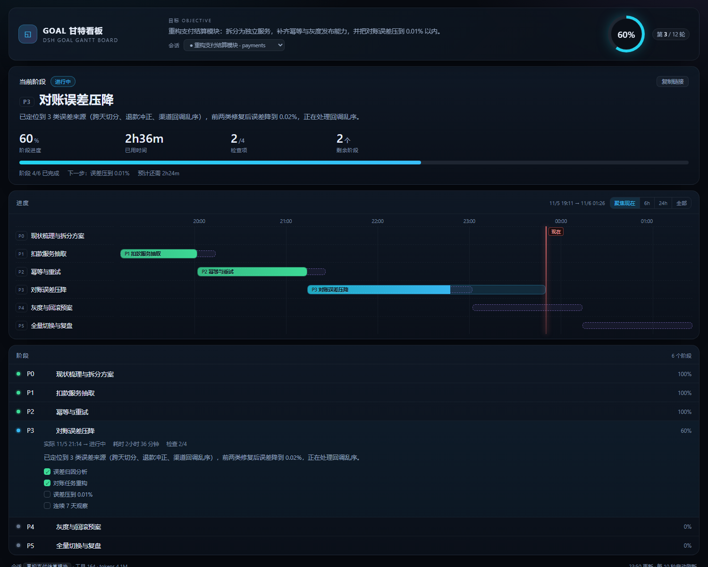
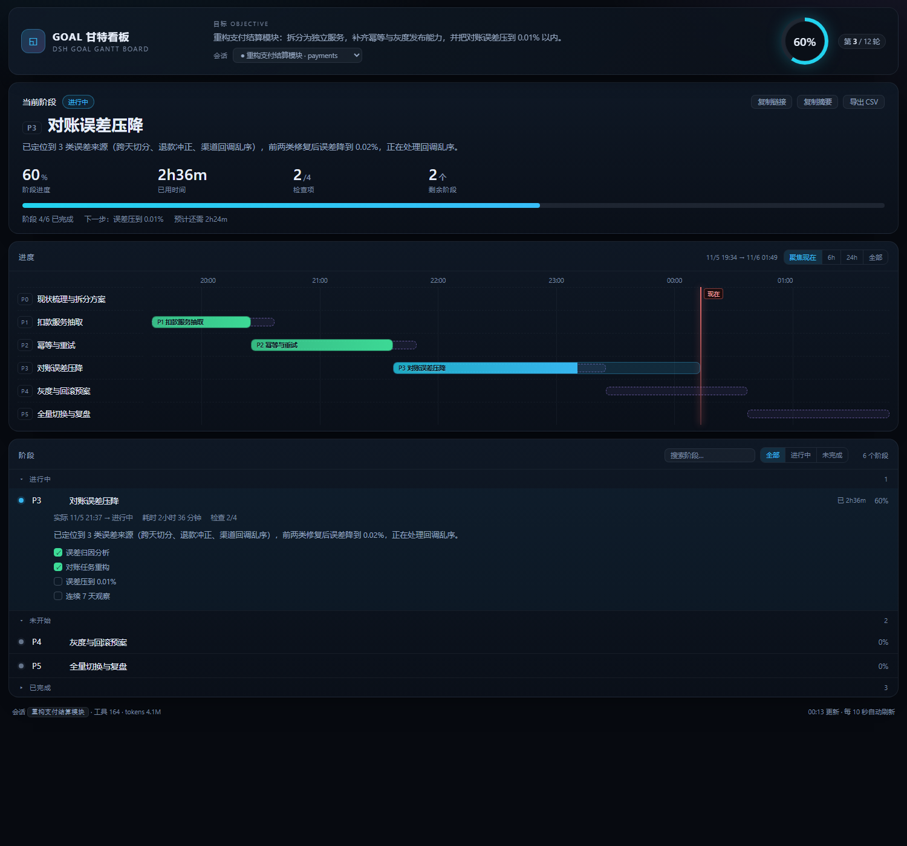
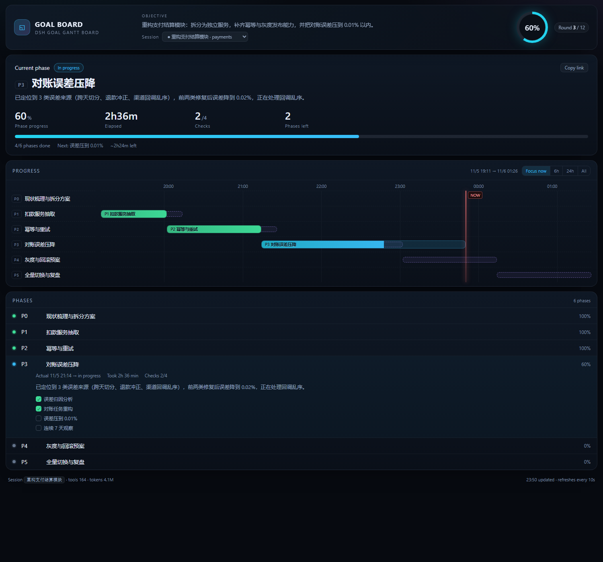

# dsh-goal-gantt · Goal Gantt Board

[中文](README.md) | English

> Phase-level progress board for [DeepSeek Harness](https://github.com/deepseek-ai/deepseek-harness): current phase, one-line summary, four key numbers, a focused Gantt timeline and a collapsible phase list.

It does not record individual tool calls. It slices a long task into **chapters (phases)** and answers three questions:

1. Which chapter is the goal in right now?
2. What did each chapter actually do, produce, and leave unfinished?
3. How far is the goal — phases left, rounds left, estimated time?



The UI ships in Chinese and English and follows the system language (`?lang=zh` / `?lang=en` override it):

| 中文 | English |
|---|---|
|  |  |

## Features

**Three things at a glance**: what you are doing now (headline + one-line summary), four numbers for that phase (progress / elapsed / checks / phases left), and how much is left overall. Only the goal, session picker and overall ring stay in the header; everything else is deferred into the phase list.

- **Gantt timeline** — planned (dashed) and actual (solid) bars, tick step adapts to the span (15 min / 1 h / 6 h / 1 day)
- **Focus now by default** — opens on a window around the current time, sized from the active phase
- **Zoom presets** — Focus now / 6h / 24h / All; the view re-centres when "now" drifts past 85% of the window
- **Reusable phases** — the same `id` may appear several times; segments merge into one lane with one bar per segment
- **Current chapter** — the active phase is picked automatically, with elapsed time, tool calls, check progress and recent turns
- **Per-phase summaries** — summary, checks and deliverables, expanded on demand
- **Filter and search** — All / Active / Open plus a search box (id, title, summary); press `/` to focus it
- **Shareable filters** — the filter and query live in the URL (`?q=P3&f=active`) and are included in copied links
- **Copy summary** — copies the current progress as Markdown (status icons, phase list, time left) for issues or chat
- **Export CSV** — the phase table (id, title, status, progress, planned/actual times, duration, checks, summary) downloads as a BOM-prefixed CSV that opens in Excel
- **Grouped by status** — In progress / Not started / Done, with Done collapsed by default
- **Relative time** — each row shows “5h ago” or “2h36m in”; expansion and group state persist in localStorage
- See [CHANGELOG.md](CHANGELOG.md)
- **Distance to goal** — remaining phases, rounds and estimated time, folded into the hero
- **Inline rendering** — lives in the conversation view ring (`对话 / 轨迹 / 看板`), styles isolated with Shadow DOM; a standalone page is available too
- **No flicker** — a content fingerprint keeps the DOM stable while only the time cursor moves
- **Empty state** — sessions without a goal get an explanation plus a copyable `board.config.json` example
- **Skeleton + retry** — first paint shows a skeleton; failures show the reason, a retry button and a link to the standalone page
- **Sticky header** — goal, ring and session picker stay visible while scrolling
- **Click to locate** — clicking a rail item or bar scrolls to that phase and flashes it; Enter/Space works too
- **Light theme** — follows `prefers-color-scheme`, respects `prefers-reduced-motion`
- **Keyboard accessible** — bars and phase rows are focusable with `aria-label` / `aria-controls`; contrast ≥ 4.5:1
- **Deep links** — "Copy link" yields `/goal-gantt?session=…#P3`, opening it expands that phase
- **Bad configs survive** — invalid dates, missing ids, non-array `phases` and out-of-range progress are normalised
- **Polling pauses** when the tab is hidden
- **Multi-session** — switch to another session's goal from the header dropdown
- **Zero dependencies, no build step** — Node built-ins only, hand-written browser bundle
- **Fully offline** — reads local session files, no network calls, no telemetry

## Install

### Marketplace

Once the repo carries the `dsh-plugin` topic it enters the marketplace index; search `goal-gantt` in DSH's plugin page.

### CLI

```bash
dsh plugin add github:123David-yang/dsh-goal-gantt
```

### Manual script

```powershell
pwsh -File scripts/install.ps1
```

The script locates `$env:DSH_HOME/profiles/web` (or `~/.dsh/profiles/web`), copies the package into `node_modules` and registers `cordis.patch.yml`.

Restart DSH once; a **看板 / Board** tab appears next to 对话 and 轨迹.

## Usage

- Open the **Board** tab in the session header — the board renders inside the current session, no navigation, no new page
- Styles live in a Shadow DOM, so nothing leaks into DSH's own CSS
- Standalone page: `http://127.0.0.1:3080/goal-gantt`
- Deep link: `/goal-gantt?session=<id>#P3`

The page polls `/api/goal-gantt` every 10 seconds and reflects phase changes.

## Where phases come from

It reads `goal-board/board.config.json` from the workspace:

```jsonc
{
  "title": "Goal Gantt Board",
  "phases": [
    {
      "id": "P1",
      "title": "Data layer",
      "desc": "One line about this chapter",
      "status": "done",                        // done | active | pending | blocked
      "plannedStart": "2026-11-05T00:05:00+08:00",
      "plannedEnd":   "2026-11-05T00:14:00+08:00",
      "startedAt":    "2026-11-05T00:05:40+08:00",
      "endedAt":      "2026-11-05T00:13:30+08:00",
      "summary": "What actually happened in this chapter",
      "checks": [{ "label": "sub task", "done": true }],
      "deliverables": [{ "label": "file", "path": "relative/or/absolute/path" }]
    }
  ]
}
```

**Scope**: the config applies only to sessions in the same workspace that have a goal, so unrelated conversations do not share one board. Pin it further with `sessionId` or `goalId`; sessions without a goal show the empty state.

Without a config it falls back to `goal_round` boundaries, then to conversation turns.

Phase progress = share of completed `checks`; without checks it is estimated from status (done=100 / active=40 / pending=0).

**Reusing a phase**: the same `id` may repeat; segments merge into one lane with one bar each, status is active if any segment is active, duration is summed.

## Performance

- Only relevant events are parsed (`turn/start`, `tool/call`, messages, goal changes); the bulkiest `tool/result` lines are filtered out before `JSON.parse`
- Projection cache and logs are cached by `mtime + size`
- Benchmark (`node test/perf.test.mjs`): 9.5 MB / 20k events, cold ~25 ms, warm < 1 ms, wired into CI
- Groups render at most 40 rows, the rest collapse behind “show more”, so huge boards stay cheap
- The session list is cached for 3 s to avoid rescanning the directory

## Data sources

| Data | Location |
|---|---|
| goal state, rounds, tokens, turn outline | `$DSH_HOME/storages/session_projcache/sessions/*.json` |
| precise event timeline (turn / tool / goal changes) | `$DSH_HOME/sessions/<cwd>/<session>/session.v4.jsonl.zstd` |

Session logs are **multi-frame zstd** (one frame per flush); Node's `zstdDecompressSync` only decodes the first frame. The plugin walks the `28 B5 2F FD` frame magic and concatenates every frame — this is the key compatibility trick.

## Privacy

- Read-only: never writes sessions or configs
- Offline: no network calls, no telemetry
- In-memory only: parsed results cached for a second, keyed by mtime
- Routes go through DSH's `connection.requestRejection` trust fence

## Compatibility

- DSH web profile, `@deepseek-ai/dsh` **0.2.x**
- Node.js **>= 22** (needs `zlib.zstdDecompressSync`; older versions degrade to projection-only)
- Windows / macOS / Linux

## Development

```bash
node test/host.test.mjs     # data layer, routes, auth
node test/render.test.mjs   # DOM-stub render checks (zh + en)
node test/a11y.test.mjs     # WCAG contrast + ARIA wiring
node test/config.test.mjs   # malformed configs
node test/perf.test.mjs     # large-session benchmark
node test/panel.test.mjs    # Shadow DOM mount via headless Chrome
```

## Layout

```
dsh-goal-gantt/
├── lib/
│   ├── index.js          host side: /goal-gantt and /api/goal-gantt
│   ├── board-data.js     session discovery, zstd decoding, phase model
│   ├── view.js           HTML template (inlines CSS/JS/first paint)
│   ├── client.js         browser side: conversation view tab
│   └── assets/           board.css, board.js
├── scripts/install.ps1   manual install
├── test/                 test suite and demo data
└── cordis.patch.yml      plugin registration
```

## License

MIT
