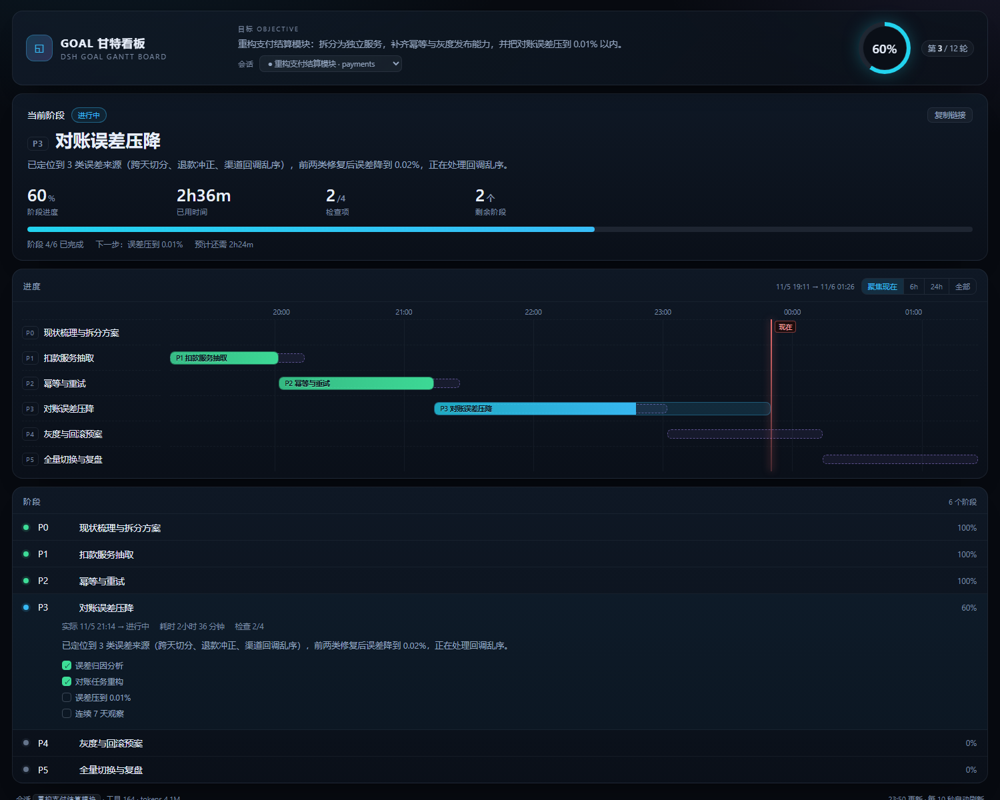
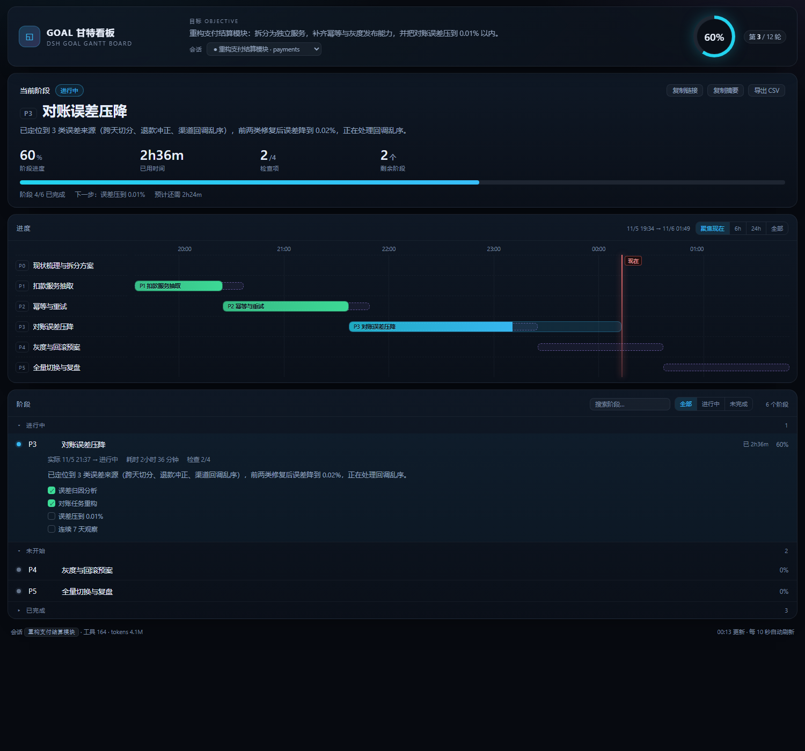
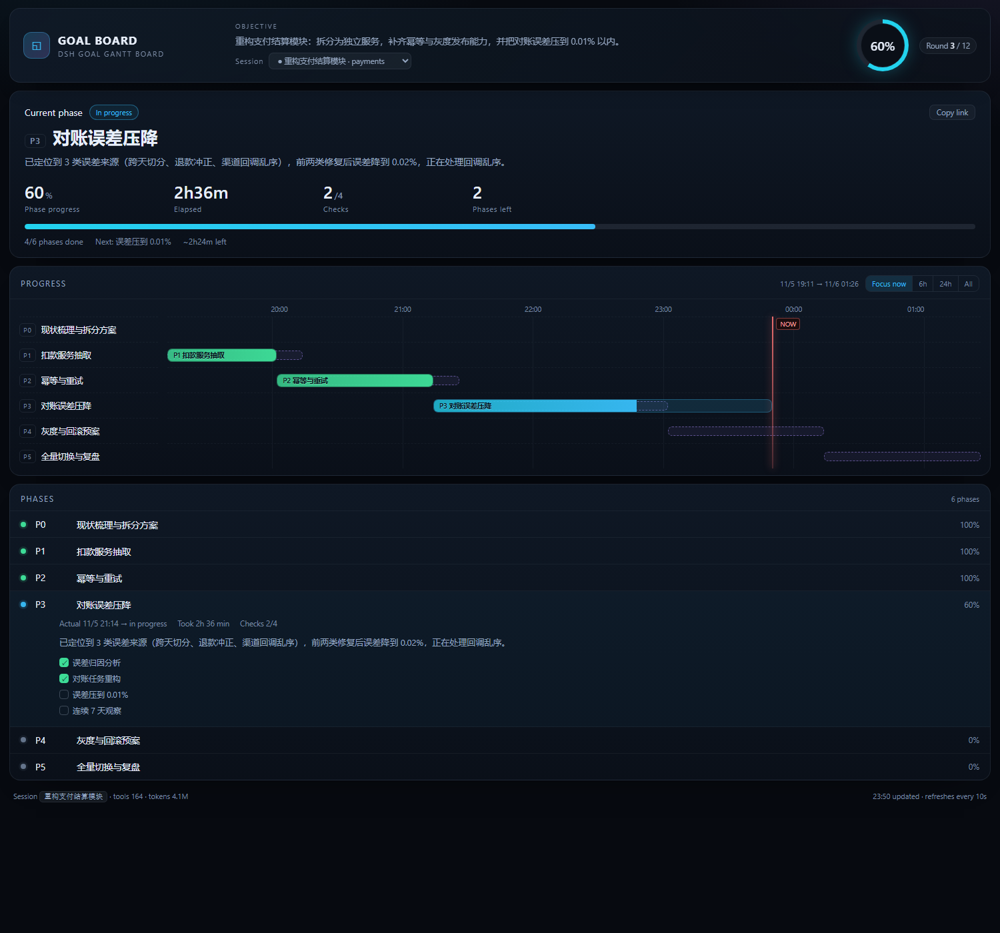

# dsh-goal-gantt · Goal 甘特看板

中文 | [English](README.en.md)

> Phase-level progress board for DeepSeek Harness: current phase, one-line summary, key numbers, a focused Gantt timeline and a collapsible phase list. UI auto-switches between Chinese and English (`?lang=en` / `?lang=zh`).

为 [DeepSeek Harness](https://github.com/deepseek-ai/deepseek-harness) 提供的 **goal 阶段级进度看板**。

它不记录单个工具调用，而是把一次长任务切成若干「章节（阶段）」，回答三个问题：

1. 这个 goal 现在走到第几章？
2. 每一章做了什么、产出什么、还剩什么没做？
3. 距离目标还有多远（阶段数 / 轮次 / 预估时间）？



中文 / English 两套界面，按系统语言自动切换（`?lang=zh` / `?lang=en`）：

| 中文 | English |
|---|---|
|  |  |

## 特性

**一屏看懂三件事**：当前在做哪一阶段（大标题 + 一句话总结）、这一阶段的四个关键数字（进度 / 已用 / 检查项 / 剩余阶段）、以及整体还剩多少。
只有「目标 + 会话 + 总进度」留在顶部，其余指标下放到阶段清单里按需展开。

- **甘特时间轴**：计划条（虚线）与实际条（实线）叠加，按时间跨度自动切换刻度（15 分钟 / 1 小时 / 6 小时 / 1 天）
- **默认聚焦现在**：打开就看当前时间窗口（以进行中阶段的时长为尺度）
- **时间轴缩放**：聚焦现在 / 6h / 24h / 全部 四档；「现在」逼近窗口边缘时自动重新取窗（不会跑出视野）
- **阶段可复用**：同一个 `id` 写多条配置会合并成一条泳道，各时间段单独画条（适合「间断优化」这类反复出现的工作）
- **Hero 当前阶段**：自动定位进行中的阶段，显示阶段名、一句话总结与四个关键数字
- **阶段清单**：每阶段一行，展开才看摘要、检查项与产出物（默认只展开进行中的那条）
- **筛选与搜索**：全部 / 进行中 / 未完成 三档切换，加一个搜索框（按 id、标题、摘要匹配），按 `/` 直接聚焦搜索
- **筛选可分享**：筛选与搜索词写进 URL（`?q=P3&f=active`），「复制链接」会把它们一起带上
- **复制摘要**：一键把当前进度复制成 Markdown（状态图标 + 阶段列表 + 剩余时间），可直接贴到 issue / IM
- **导出 CSV**：阶段表（id / 标题 / 状态 / 进度 / 计划与实际时间 / 耗时 / 检查项 / 摘要）一键下载，带 BOM 可直接用 Excel 打开
- **按状态分组**：进行中 / 未开始 / 已完成 三组，已完成默认折叠（点表头展开）
- **相对时间**：每行显示「5 小时前」/「已 2h36m」；展开状态与分组状态记在 localStorage，刷新不丢
- 版本记录见 [CHANGELOG.md](CHANGELOG.md)
- **距目标**：剩余阶段、轮次与预估时间，收进 Hero 底部一行
- **内嵌渲染**：作为 main 面板直接长在 DSH 里，Shadow DOM 隔离样式；也可一键新标签打开
- **不闪、不跳**：内容指纹（signature）不变时只移动时间游标，不重建 DOM；阶段状态变化才重绘
- **没有 goal 的会话**显示空态提示，不会按对话轮次编造阶段
- **加载骨架屏 / 失败重试**：首屏先出骨架，加载失败给出原因、重试按钮和独立页面入口
- **吸顶头部**：滚动时目标、进度环、会话选择器始终可见
- **点击定位**：点甘特条或阶段行，直接滚到对应阶段并高亮；支持键盘 Enter/Space
- **浅色主题**：跟随系统 `prefers-color-scheme` 自动切换，并支持 `prefers-reduced-motion`
- **键盘可达**：甘特条与阶段行都能 Tab 聚焦、Enter/Space 展开，带 `aria-label` / `aria-controls`；正文与辅助文字对比度均在 4.5:1 以上
- **中英双语**：按系统语言自动切换，也可用 `?lang=zh` / `?lang=en` 强制
- **深链分享**：Hero 右上角「复制链接」给出 `#P3` 这种直达地址，打开就展开并定位到该阶段
- **坏配置不崩**：非法时间、缺 id、`phases` 不是数组、进度越界都会收敛，不会出现 NaN 或负宽度条形
- **空态有引导**：没有 goal 时直接给一段可复制的 `board.config.json` 示例
- 标签页不可见时暂停轮询，不打扰 DSH 其它功能
- **多会话切换**：页头下拉可直接切换到其它会话的 goal（● 表示该会话有 goal）
- **零依赖、零构建**：只用 Node 内置模块，浏览器侧手写 bundle，装完即用
- **完全离线**：只读本机会话文件，不发任何网络请求，不落任何数据

## 安装

### 方式一：插件市场（推荐）

仓库打了 `dsh-plugin` topic 后会自动进入市场索引，在 DSH Web GUI 的插件页搜索 `goal-board` 一键安装。

### 方式二：CLI

```bash
dsh plugin add github:123David-yang/dsh-goal-gantt
```

### 方式三：手动脚本

```powershell
# Windows
pwsh -File scripts/install.ps1
```

脚本会自动定位 `$env:DSH_HOME/profiles/web`（或 `~/.dsh/profiles/web`），把插件复制进 `node_modules` 并注册 `cordis.patch.yml`。

安装后**重启一次 DSH**，会话顶部出现「看板」标签页。

## 使用

- **会话顶部的「看板」标签页**（就在「对话 / 轨迹」旁边）——点开即在当前会话内展示，
  不跳转、不新开页面；切换会话时自动跟随
- 渲染走 Shadow DOM，样式与宿主完全隔离，不会污染 DSH 自己的 CSS
- 也可以直接访问 `http://127.0.0.1:3080/goal-gantt` 看独立页面

页面每 10 秒自动拉一次 `/api/goal-gantt`，阶段状态变化会实时反映。

## 阶段从哪来

优先读取工作区里的 `goal-board/board.config.json`：

```jsonc
{
  "title": "GOAL 甘特看板",
  "phases": [
    {
      "id": "P1",
      "title": "数据采集层",
      "desc": "一句话说明这一章干什么",
      "status": "done",                        // done | active | pending | blocked
      "plannedStart": "2026-11-05T00:05:00+08:00",
      "plannedEnd":   "2026-11-05T00:14:00+08:00",
      "startedAt":    "2026-11-05T00:05:40+08:00",
      "endedAt":      "2026-11-05T00:13:30+08:00",
      "summary": "这一章实际做了什么（显示在总结卡上）",
      "checks": [{ "label": "子任务", "done": true }],
      "deliverables": [{ "label": "文件", "path": "relative/or/absolute/path" }]
    }
  ]
}
```

**作用域**：配置默认只对「同一工作区、且当前有 goal」的会话生效，避免一个工作区里所有会话看到同一份看板。
也可以用 `sessionId` 或 `goalId` 精确绑定；没有 goal 的会话显示空态提示。

没有配置文件时自动降级：按 `goal_round` 轮次切分阶段；再没有就按对话轮次切分。

阶段进度 = `checks` 完成比例；没有 checks 时按状态估算（done=100 / active=40 / pending=0）。

**复用阶段**：同一个 `id` 可以出现多次，看板会把它们合并成一条泳道、每段画一根条，
状态取「有进行中则进行中，否则看最后一段」，耗时按各段累加。例如：

```jsonc
{ "id": "P8", "title": "时间轴优化", "status": "done",   "startedAt": "...", "endedAt": "..." },
{ "id": "P9", "title": "文档",       "status": "done",   "startedAt": "...", "endedAt": "..." },
{ "id": "P8", "title": "时间轴优化", "status": "active", "startedAt": "..." }   // 又回来优化一次
```

甘特图上 P8 会是一行、两根条。

## 性能

- 解析会话日志时**只解析用得上的事件**（`turn/start`、`tool/call`、消息、goal 变更），占体积最大的 `tool/result` 先行文本过滤、不进 `JSON.parse`
- 投影缓存与日志都按 `mtime + size` 缓存，重复请求只做一次解析
- 基准（`node test/perf.test.mjs`）：9.5 MB / 20k 事件的会话，冷启动约 **25 ms**，热调用 **< 1 ms**，已接入 CI
- 分组内超过 40 条时只渲染前 40 条，其余折叠为「显示更多」，避免上千阶段时 DOM 过大
- 会话列表有 3 秒 TTL 缓存，会话很多时不重复扫描目录

## 数据来源

| 数据 | 位置 |
|---|---|
| goal 状态、轮次、token、轮次大纲 | `$DSH_HOME/storages/session_projcache/sessions/*.json` |
| 精确事件时间线（turn / tool / goal 变更） | `$DSH_HOME/sessions/<cwd>/<session>/session.v4.jsonl.zstd` |

会话日志是**多帧拼接的 zstd**（每次写入一帧），Node 原生的 `zstdDecompressSync` 只解第一帧。插件按帧魔数 `28 B5 2F FD` 逐帧解压再合并 —— 这是本插件最关键的一段兼容逻辑。

## 隐私

- 只读：不写会话、不改配置
- 离线：不发任何网络请求，无遥测
- 不落盘：解析结果只在内存里按 mtime 缓存 1 秒
- 路由受 DSH 的 `connection.requestRejection` 信任围栏保护（Host/Origin + 登录 cookie），绑到局域网也不会裸奔

## 兼容性

- DSH Web profile，`@deepseek-ai/dsh` **0.2.x**
- Node.js **>= 22**（依赖 `zlib.zstdDecompressSync`；更低版本会退化为只读投影缓存，日志事件不可用）
- 平台：Windows / macOS / Linux（Windows 为主线开发环境）

## 开发

```bash
node test/host.test.mjs     # 数据层 + 路由 + 鉴权
node test/render.test.mjs   # DOM 桩渲染（中英两套断言）
node test/a11y.test.mjs     # WCAG 对比度 + ARIA 接线
node test/config.test.mjs   # 异常配置边界
node test/perf.test.mjs     # 大会话基准
node test/panel.test.mjs    # Shadow DOM 挂载（无头 Chrome）
```

## 结构

```
dsh-goal-gantt/
├── lib/
│   ├── index.js          host 半侧：/goal-gantt 与 /api/goal-gantt
│   ├── board-data.js     会话发现、zstd 解码、阶段模型
│   ├── view.js           HTML 模板（内联 CSS/JS/首屏数据）
│   ├── client.js         浏览器半侧：会话视图标签
│   └── assets/           board.css、board.js
├── scripts/install.ps1   手动安装
├── test/                 自测与演示数据
└── cordis.patch.yml      插件注册清单
```

## License

MIT


